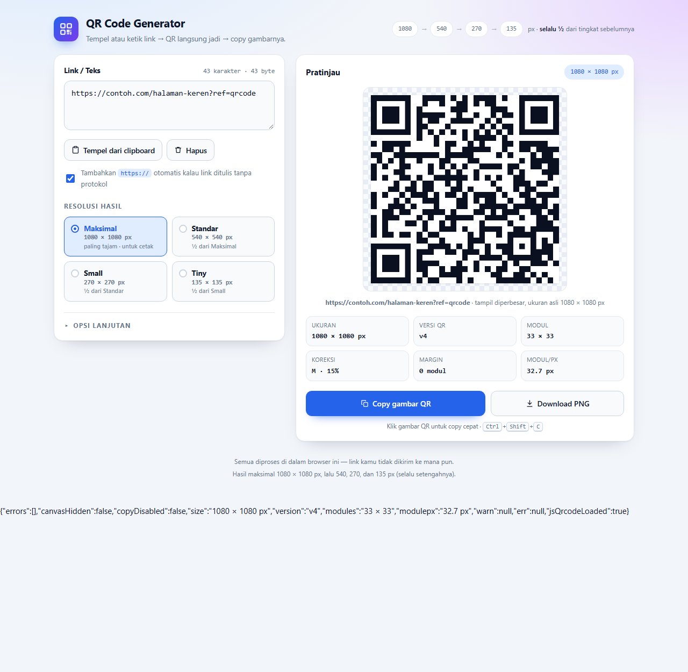
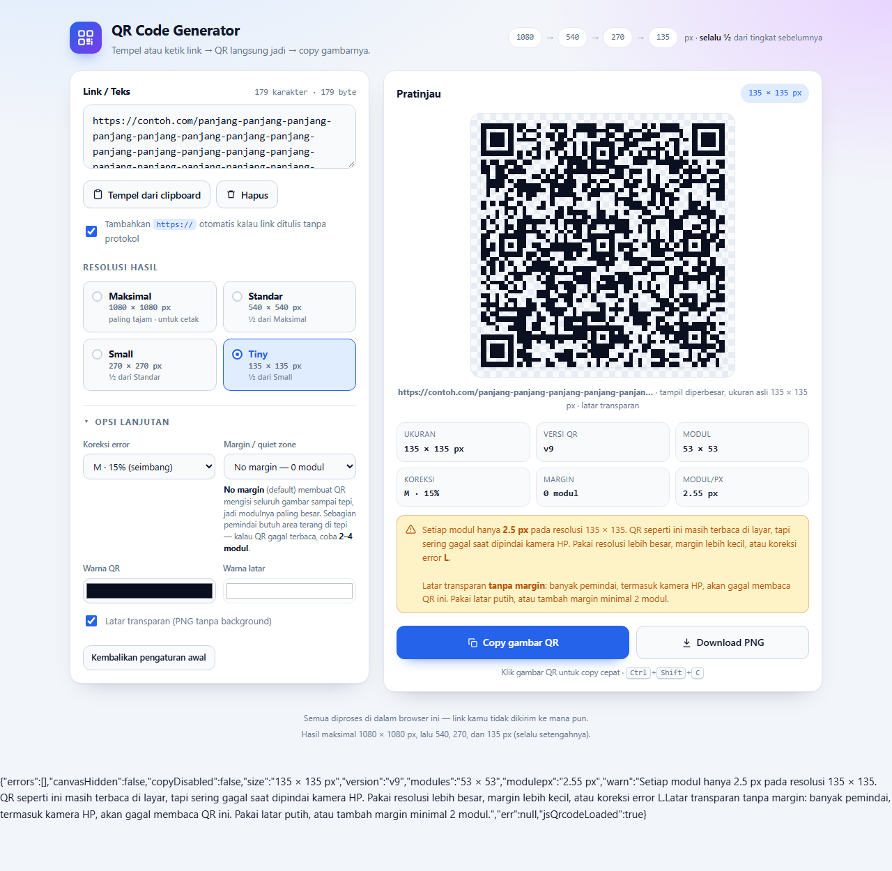

# QR Code Generator — Link jadi QR, langsung bisa di-copy

Aplikasi satu file: buka **`index.html`** dengan klik dua kali di browser. Tidak perlu server,
tidak perlu internet, dan tidak ada data yang dikirim ke mana pun.



## Cara pakai

1. **Tempel atau ketik link** di kotak "Link / Teks" (bisa `Ctrl+V` di mana saja di halaman —
   teksnya otomatis masuk ke kotak). Tombol **Tempel dari clipboard** mengambil isi clipboard
   langsung, dan `https://` ditambahkan otomatis kalau link ditulis tanpa protokol.
2. QR langsung muncul di panel **Pratinjau** (tanpa perlu klik tombol apa pun).
3. Klik **Copy gambar QR** → gambar PNG masuk ke clipboard, siap di-`Ctrl+V` ke WhatsApp, Word,
   Canva, chat, dsb. Bisa juga **klik gambar QR-nya** langsung, atau tekan `Ctrl+Shift+C`.
4. Butuh file? Klik **Download PNG**.

## Resolusi hasil

Setiap tingkat selalu **setengah** dari tingkat di atasnya:

| Tingkat | Ukuran | Catatan |
| --- | --- | --- |
| Maksimal | 1080 × 1080 px | paling tajam, untuk cetak |
| Standar | 540 × 540 px | ½ dari Maksimal |
| Small | 270 × 270 px | ½ dari Standar |
| Tiny | 135 × 135 px | ½ dari Small |

Ukuran PNG yang dihasilkan **persis** angka tersebut (bukan hasil penskalaan gambar), dan tiap
modul QR digambar tepat di batas piksel sehingga hasilnya tajam, bukan buram.

Karena **No margin** aktif secara default, QR mengisi gambar sampai tepi — jadi seluruh
1080 × 1080 px dipakai modul QR dan modulnya jadi paling besar (32.7 px pada contoh di atas,
naik dari 26.3 px kalau memakai margin 4 modul).

## Opsi lanjutan

- **Margin (quiet zone)** 0–8 modul. Default **No margin — 0 modul** (QR penuh sampai tepi).
  Standar QR sebenarnya menyarankan 4 modul area terang; sebagian pemindai butuh itu. Kalau QR
  gagal terbaca, naikkan ke 2–4 modul.
- **Koreksi error** L / M / Q / H — makin tinggi makin tahan kotor, tapi QR jadi lebih padat.
- **Warna QR & warna latar**, plus opsi **latar transparan** (PNG tanpa background).
- Pengaturan dan isi kotak teks otomatis tersimpan di browser, jadi tidak hilang saat ditutup.

## Catatan & batasan

- Aplikasi memperingatkan kalau QR terlalu padat untuk ukuran yang dipilih (mis. link panjang
  di 135 px) dan menolak menggambar (dengan saran perbaikan) kalau kontennya benar-benar tidak
  muat pada resolusi itu. Kombinasi **latar transparan + No margin** juga diberi peringatan
  karena banyak pemindai gagal membaca QR tanpa area terang di tepi:

  
- Copy gambar memakai `navigator.clipboard.write` + `ClipboardItem`. Saat `index.html` dibuka
  langsung lewat `file://`, Chrome/Edge menganggapnya secure context sehingga fitur ini jalan
  normal. Kalau browser menolak (mis. Firefox), aplikasi otomatis jatuh ke mode kompatibilitas
  (seleksi + `execCommand('copy')`), dan kalau itu juga gagal file PNG diunduh sebagai gantinya.
- Aplikasi harus dalam keadaan **aktif/fokus** saat menekan tombol copy; kalau jendelanya tidak
  fokus, browser menolak akses clipboard.

## Struktur file

```
index.html                  ← DELIVERABLE: aplikasi mandiri (pustaka QR sudah di dalamnya)
vendor/qrcode-generator.js  ← pustaka QR (MIT, Kazuhiko Arase) — sumber untuk build
src/app.template.html       ← sumber kode aplikasi (HTML + CSS + JS), ada penanda pustaka
src/build.mjs               ← gabungkan template + pustaka → index.html
src/selftest.mjs            ← tes cepat: sintaks + pustaka + matematika resolusi
src/dom-test.mjs            ← tes integrasi: jalankan skrip aplikasi di DOM tiruan, cek piksel
src/prepare-browser-test.mjs← siapkan halaman untuk screenshot headless Chrome
_verify/                    ← hasil uji (contoh QR & screenshot UI)
```

`index.html` **dibangun otomatis** — jangan diedit langsung. Ubah `src/app.template.html`,
lalu jalankan build.

## Build & tes

```powershell
node src/build.mjs        # bangun ulang index.html
node src/selftest.mjs     # tes sintaks + pustaka + pembagian resolusi
node src/dom-test.mjs     # 68 tes integrasi (jalankan aplikasi sungguhan di DOM tiruan)
```

`dom-test.mjs` memeriksa hal yang paling mudah salah: untuk keempat resolusi, setiap modul QR
dibaca kembali dari piksel canvas yang benar-benar digambar aplikasi dan dibandingkan dengan
matriks QR aslinya — hasilnya 0 modul salah, termasuk pada 135 px.

## Lisensi

Pustaka QR: [qrcode-generator](https://github.com/kazuhikoarase/qrcode-generator) oleh
Kazuhiko Arase, lisensi MIT. Sisa kode aplikasi ini bebas dipakai.
